<p align="center">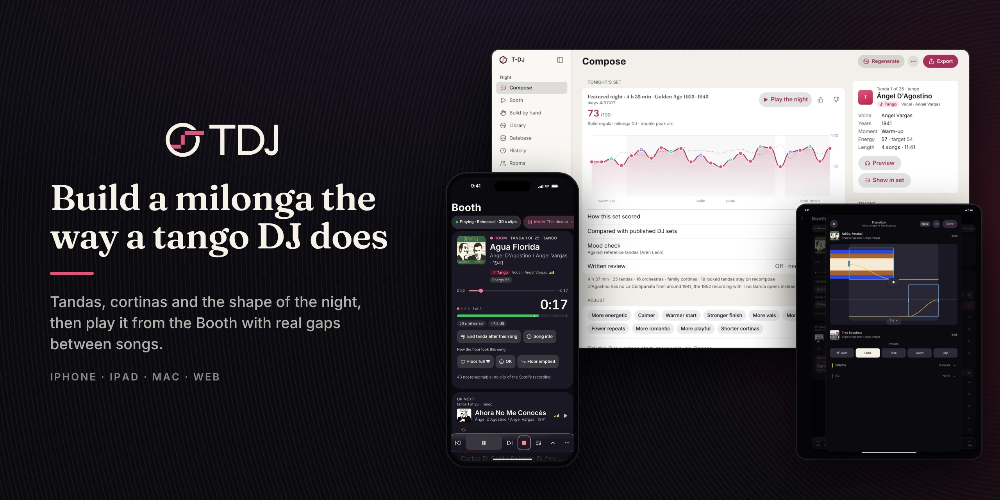</p>
<h1 align="center">T-DJ</h1>
<p align="center">Build a milonga the way a tango DJ does: tandas, cortinas and the shape of the night.</p>

<p align="center"><a href="media/readme/hero.mp4">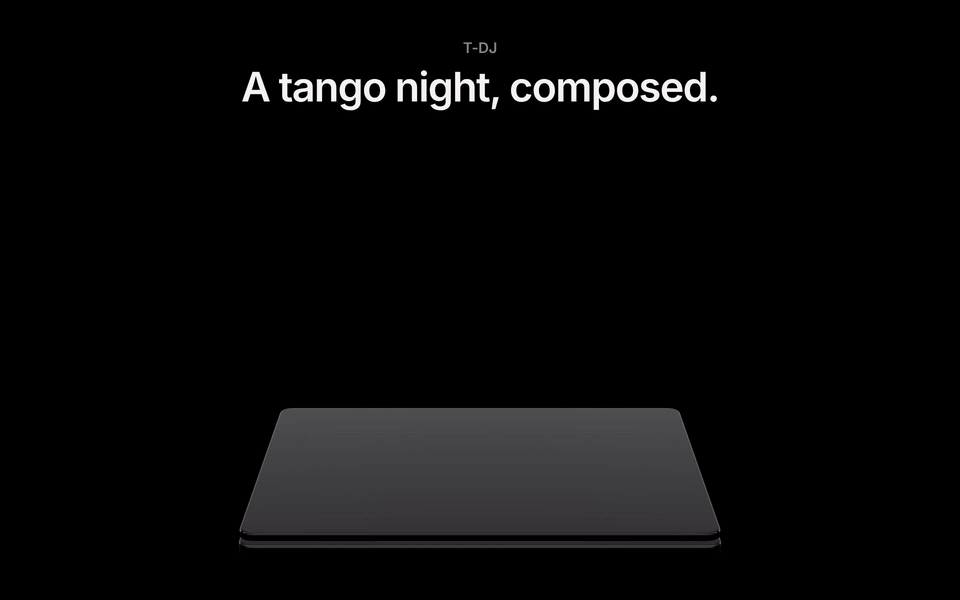</a></p>

I play milongas in Istanbul. For years I built every night by hand, checking that no orchestra came back too
soon and that each cortina fit the tanda after it. T-DJ is the tool I wanted for that job. It drafts a whole night
from an index of about 19,000 recordings, then lets me change what I don't like before I play it, and plays it.

## Get T-DJ

One app for iPhone, iPad and Mac, plus the web. They all carry the same version number and ship from the same
commit ([docs/RELEASING.md](docs/RELEASING.md)).

<!-- app-store:coming-soon (scripts/release/readme-store-badge.mjs removes these marker lines and the notes once App Review approves) -->
<p align="center">
  <a href="https://apps.apple.com/app/id6834924534"><picture><source media="(prefers-color-scheme: dark)" srcset="media/badges/download-on-the-app-store-white-en-us.svg"></picture></a>&nbsp;&nbsp;
  <a href="https://apps.apple.com/app/id6834924534?platform=mac"><picture><source media="(prefers-color-scheme: dark)" srcset="media/badges/download-on-the-mac-app-store-white-en-us.svg"></picture></a>&nbsp;&nbsp;
  <a href="docs/SELF_DEPLOY.md"><picture><source media="(prefers-color-scheme: dark)" srcset="media/badges/deploy-your-own-web-app-white.svg"></picture></a>&nbsp;&nbsp;
  <a href="https://github.com/ArioMoniri/TDJ/releases/latest/download/T-DJ-macOS.dmg"><picture><source media="(prefers-color-scheme: dark)" srcset="media/badges/download-the-mac-dmg-white.svg"></picture></a>
</p>
<p align="center"><a href="https://github.com/ArioMoniri/TDJ/releases/latest"></a>&nbsp;<sub>The DMG button always downloads the <a href="https://github.com/ArioMoniri/TDJ/releases/latest">latest release</a>; every release lists the same buttons and a <code>SHA256SUMS</code> file.</sub></p>
<p align="center" data-store-status="coming-soon"><sub><b>Coming to the App Store.</b> The iPhone, iPad and Mac apps are in TestFlight beta while App Review is pending; the store links open once the listing is approved.</sub></p>

- **iPhone and iPad**: iOS and iPadOS 16 or later. One universal app; the Booth keeps playing with the screen locked.
- **Mac App Store**: the same purchase as iPhone and iPad (it is free), sandboxed, macOS 13 or later.
- **Mac download**: one DMG for Apple silicon and Intel, signed and notarised, and it updates itself (it asks
  first). Each [release](https://github.com/ArioMoniri/TDJ/releases) carries a `SHA256SUMS` file:
  `shasum -a 256 -c SHA256SUMS`.
- **Web**: deploy your own in one click to your AWS account, or run it on your own computer
  ([docs/SELF_DEPLOY.md](docs/SELF_DEPLOY.md)); any key you add stays in your browser or on your server.
  Settings → About says when a newer version is live; reload when the night is over.
- **iPhone Duo**: folded it is the phone layout, open it is the sidebar layout; the night keeps playing through
  a fold.
- **Languages**: English and Turkish, in the apps, on the web and on the store listing.

## What it does

**Composes a night.** Choose the length and the era, press Compose. You get tandas in a TTVTTM cycle, a cortina
picked for the tanda that follows it, an energy arc with a breather between two peaks, and a score that tells you
what it checked. Each night gets its own cover, drawn from its arc, with an era label that follows what is
actually in it. The featured night is mine: 25 tandas, 4 h 37 min of the golden age with Turkish cortinas.

<p align="center"><a href="media/readme/compose.mp4">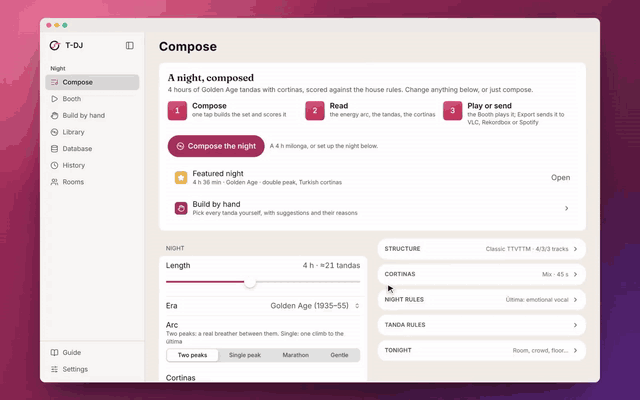</a></p>

**Plays it in the Booth.** The Booth plays the night from your own files, from Spotify, or as 30-second
rehearsal clips, with real gaps, level matching and a fade at the end of each cortina. Cortinas start at their
chorus, so the room knows a cortina when it hears one; you can move the start per cortina.

<p align="center"><a href="media/readme/booth.mp4"></a></p>

On an iPad in landscape the Booth is one screen: what plays now, the clock to La Cumparsita, the set list in its
own column, and one row of transport buttons at the bottom. What I use during a night:

- Tap any song or cortina to play it. Before the night it plays in the room; once the night has started it goes
  to your headphones first, and Play now in the room needs a confirmation. Previous, Next, Fade and Crossfade are
  press-and-hold mid-night, so a stray tap never cuts a song. You can switch that off in Settings.
- Every Booth action can be undone: ⌘Z / Ctrl+Z, ⌘Y / Ctrl+Y to redo, or shake the phone (it asks first).
- A seek bar, a start point per song, and drag (or Move up / down) to change the order inside a tanda.
- Controls opens one panel with everything else: transport, loudness trim, cue, mixer, timing, the floor.
- Find songs searches tonight's tandas or the whole catalogue, and Swap replaces a song while the room dances.
- The marker between two songs opens the transition editor: Auto, Fade, Rise, Blend or Gap, with the overlap,
  curves and EQ, and a play button to hear it.
- Spotify and YouTube sides get a level estimate from data (the catalogue, Deezer, Spotify), shown in plain
  words and applied to the night's loudness matching.
- Battery saver (Off, Auto or On) makes a long night last longer on a laptop or an iPad: the screen updates less
  often, and the sound and its timing stay exact.

<p align="center">

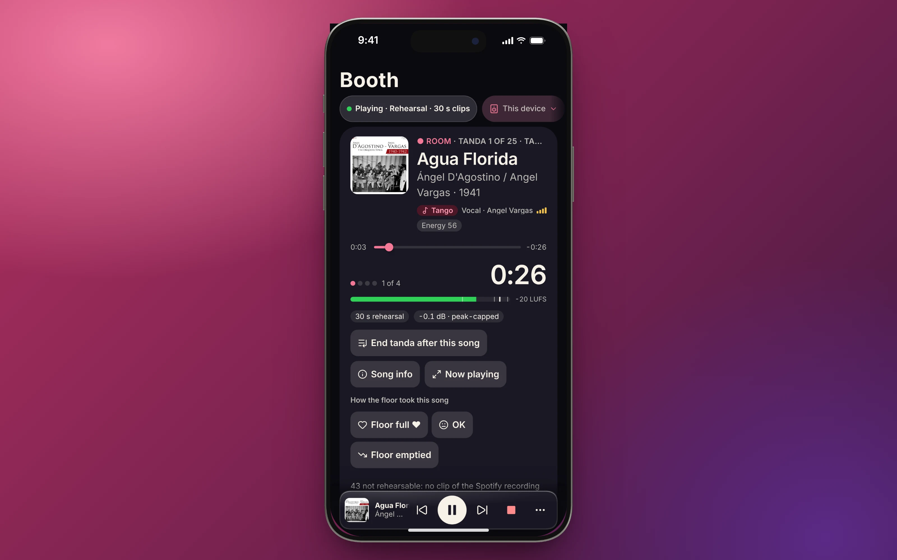
</p>

**Now playing and the Floor screen.** Now playing is one screen for the song in the room: the artwork, the
lyrics, a rhythm lane with its beats and phrases, the video, and a card for the dancers. The card shows the song's
place in the tanda (song 2 of 4: a good time to start dancing), the time left in the tanda, the next tanda and the
time to La Cumparsita. Floor screen puts that card on a projector or a TV, large and with no controls, in this
browser's second window or on any device that has the room's code.

<p align="center">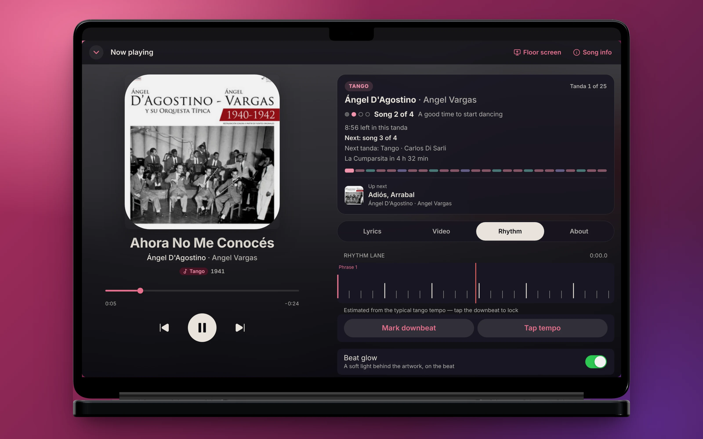</p>

<p align="center">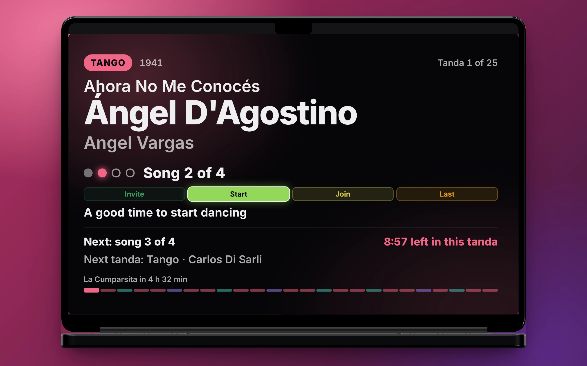</p>

**One player, on every page.** The night keeps playing while you look for something else. Its player sits in the
sidebar: what plays, the tanda and the song, the time to La Cumparsita, volume, the outputs and Now playing. Fold
the sidebar away and the player becomes a gramophone, its ring showing what is left of the song. You can drag it to
any edge or pull it out into a floating card. Without a sidebar it is the bar at the bottom.

<p align="center">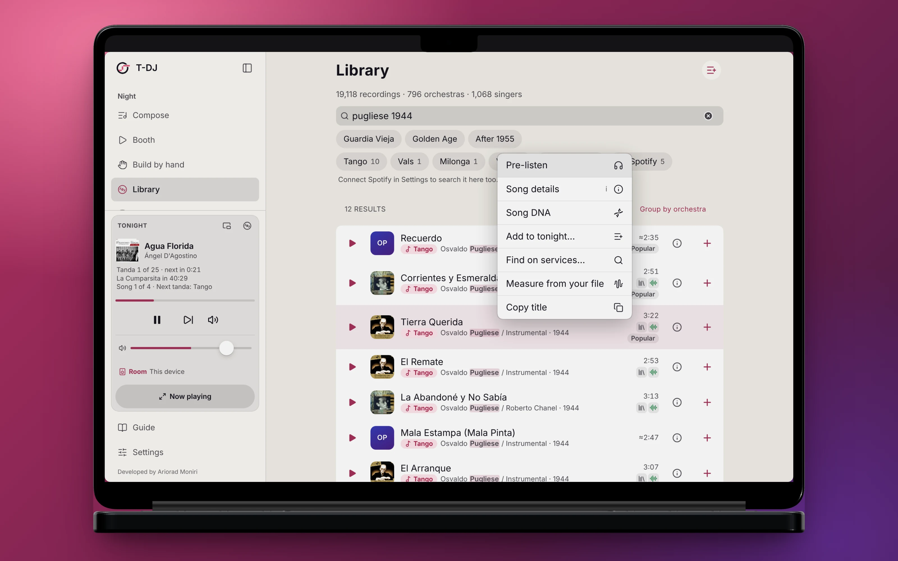</p>

**Pre-listen while the room plays.** With headphones set as the second output, play any song from the Library,
the search or the set list and it plays in your headphones only. The player shows what is in your ears, with a
Stop. Without headphones, T-DJ asks where to play it and never sends it to the room.

<p align="center">
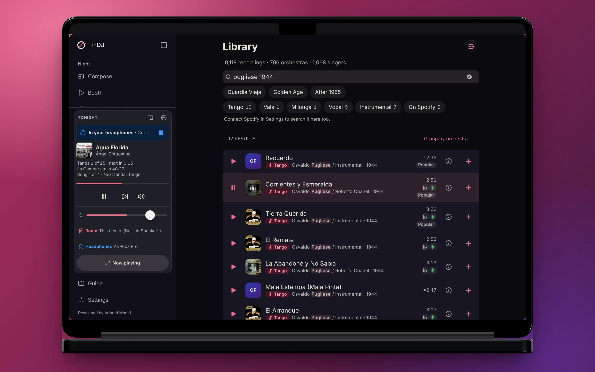
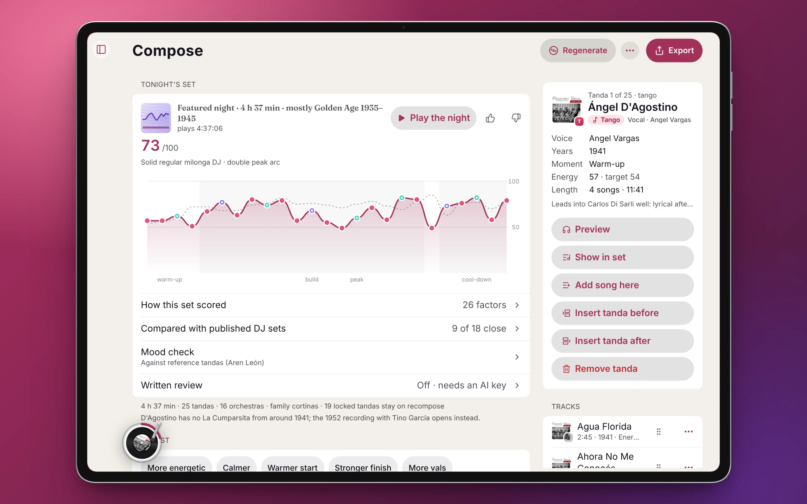
</p>

**A song menu on every row.** Right-click a song (or long-press it on a touch screen) in Compose, the Library, the
Database or the Booth: pre-listen, song details, Song DNA, add to tonight, find it on your services. The details
show the work's credits, the tempo and every other version, playable. Song DNA charts every recording of the work
over the years, with the one you picked marked.

<p align="center">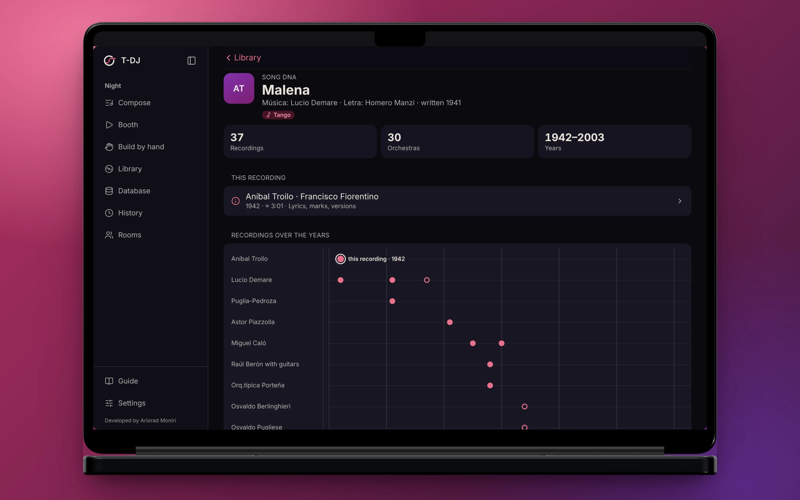</p>

**Your keys.** Click any key shown in the Keyboard sheet or in Settings, then press the new one. T-DJ warns when a
key is taken and offers to swap it, and refuses keys the browser keeps for itself.

**Spotify on the iPad and the iPhone.** Safari and the iPhone and iPad apps can't play Spotify inside the page, so
the Booth plays through the Spotify app instead (Spotify Connect, Premium needed). The ROOM menu lists your Spotify devices;
pick one and start, pause, stop and seek all work from T-DJ. When something goes wrong the Booth says so in plain
words, such as "Spotify · pick a device" or a session that needs a new login, with one button to fix it. It never
skips the rest of the night because one start failed.

**Build by hand.** If you'd rather pick every tanda yourself, Build by hand keeps a checklist next to your night:
the length against the target, the big four, the energy arc, the rhythm cycle and the cortinas, each with a
one-tap fix. On the right it suggests whole tandas for the next slot and says why each one fits. Undo and Redo sit
in the header, and Fill completes the next tanda, one cycle or the rest of the night, previewed before it is
added.

<p align="center"><a href="media/readme/build.mp4"></a></p>

**Search that forgives typing.** The Library and the Database share one search. It ignores accents and copes
with typos ("ventaron" finds Ventarrón), and you can type words in any order: "di sarli 1941 instrumental",
"pugliese 40s", "otv vals". Tap a row to hear it.

<p align="center"><a href="media/readme/search.mp4"></a></p>

**Learns what works on the floor.** In the Booth I mark a song Floor full, OK or Floor emptied. Dancers can open
the room's link on their phones and heart the song that is playing; nobody's name is kept, only counts. Popularity
from published DJ sets, set lists and Deezer gives a starting point before you have reactions of your own. A
favourite weighs more in the part of the night where it worked, and never overrides a tanda rule. Praise a tanda
and it counts as one Floor full for its songs.

<p align="center">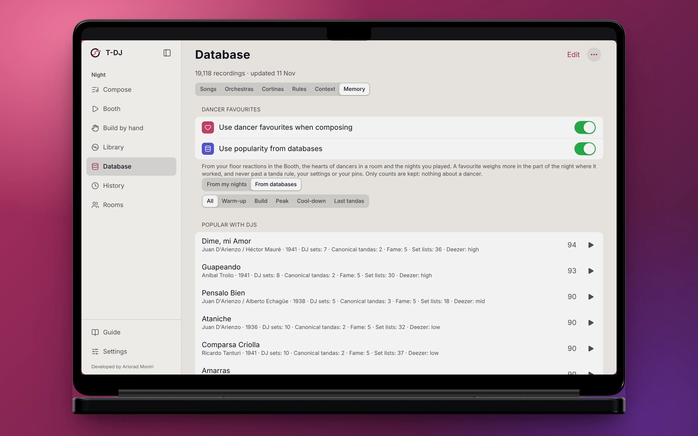</p>

Your edits teach it too: swaps, pinned tandas, thumbs up and down on a night. Settings shows what it learned as a
list you can weigh up or down, delete, or switch off.

<p align="center"></p>

**Asks before breaking a rule.** If an edit would break a tanda rule (two orchestras in one tanda, years too far
apart), T-DJ tells you what is wrong, offers up to three alternatives, and lets you do it your way for this night
only.

**Edit with AI.** Type "make tanda 7 calmer" and you see the change as a diff, with Undo. With your own key
(Anthropic, OpenAI, Gemini or OpenRouter) a model reads the request. Without a key, T-DJ reads it by keyword,
which covers most of what I ask for in the middle of a night.

<p align="center"><a href="media/readme/ai-edit.mp4">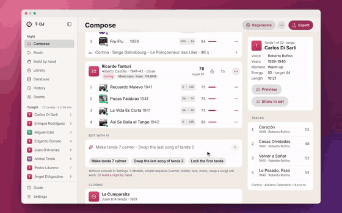</a></p>

**Rooms.** Two DJs can work on one night. I make a room and show the code, the other DJ joins from a phone, and
each edit shows up on both sides, with who made it in the log. The room has the whole night, with Compose's editing
and undo, or starts empty to be built together; the cortinas are mended after every edit, so each one still fits
the tanda after it. On the web, rooms are kept in the deployment's database; the iPhone, iPad and Mac apps use
rooms through a linked T-DJ server.

<p align="center"><a href="media/readme/rooms.mp4">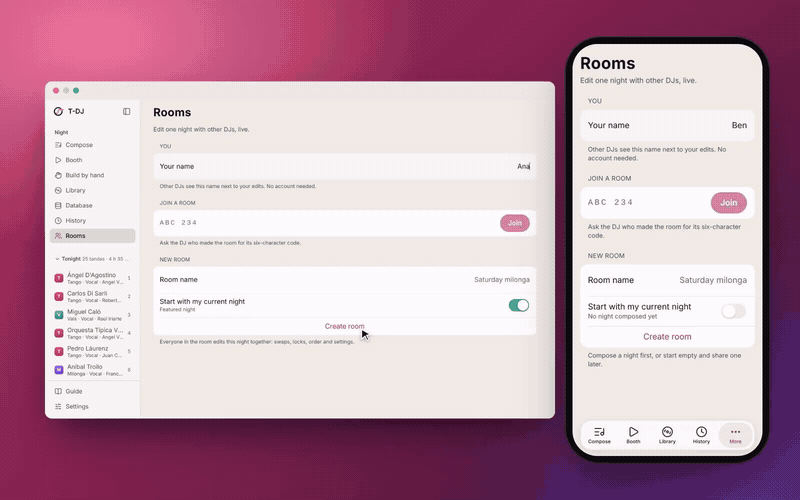</a></p>

**Share a night.** Export, then Share: a link, a `.tdjnight` file or a QR code. It opens on any phone, iPad or Mac
and lands in History.

<p align="center"><a href="media/readme/share.mp4"></a></p>

**Your own database.** Every recording, orchestra, cortina and rule can be edited, and your edits travel with your
nights. The era badges come from the orchestra heatmap, so you can see at a glance whether a side is from an
orchestra's best years. Artwork shows on every row, with the orchestra's initials when there is
none.

<p align="center"></p>

The index is mostly the golden age, but contemporary orchestras can be added from their Spotify releases with
`pnpm orchestra:import`. Sexteto Cristal is the first: 27 sides from *Viento del Norte* (2018) and *Loca de amor*
(2019).

**In Turkish, too.** The app and its store pages speak Turkish as well as English. Settings → Language follows your
system or lets you choose.

<p align="center">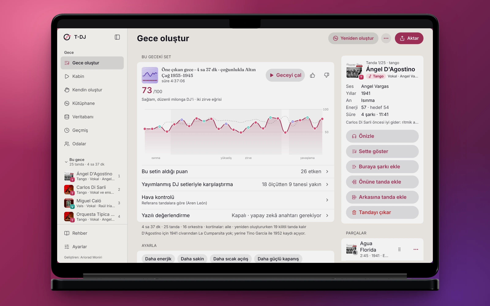</p>

It runs on the iPhone and the iPad as well, as the same app from the App Store or in the browser, and there is a
dark mode for a dim room. On the iPhone the Booth's transport sits where the tab bar was, above the home indicator,
and the set list opens from it.

<p align="center">

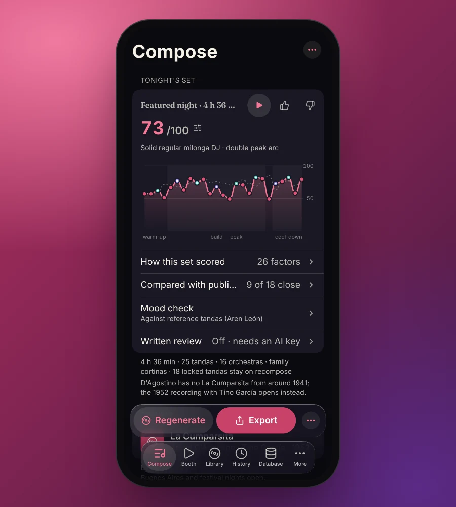
</p>

More screens: [Booth on iPad](media/readme/booth.webp) · [Build by hand](media/readme/build.webp) ·
[search](media/readme/search.webp) · [keys](media/readme/keys.webp) · [Guide](media/readme/guide.webp) ·
[Compose](media/readme/compose-light.webp) · [dark Compose](media/readme/compose-dark.webp)

## Self-host

Run your own copy on your own AWS account, with your own Spotify app and settings (about $0–1 a month when idle),
run it on your own computer with `pnpm dev`, or use the iPhone, iPad and Mac apps, which work on their own. One line
on macOS, Linux or WSL:

```bash
curl -fsSL https://raw.githubusercontent.com/ArioMoniri/TDJ/claude/admiring-curie-npzd0m/scripts/install.sh | bash
```

It prints its plan and asks first, then clones T-DJ, installs it and runs the `tdj` CLI (`pnpm tdj init`,
`pnpm tdj deploy`; `pnpm tdj doctor` when something is off).

Or deploy in one click from GitHub, with nothing running on your computer afterwards:
**[1. Fork T-DJ](https://github.com/ArioMoniri/TDJ/fork)** → 2. add the AWS deploy role (`pnpm tdj init --github`
once, or [by hand](docs/SELF_DEPLOY.md#c-one-click-on-github)) →
**[3. Run "Deploy to AWS"](https://github.com/ArioMoniri/TDJ/actions/workflows/deploy-aws.yml)** on your fork. Every
way, costs on the AWS free tier, updating and removing: [docs/SELF_DEPLOY.md](docs/SELF_DEPLOY.md). A copy starts
empty: no key or account comes with the code, and every key is one you add yourself.

## Develop

```bash
pnpm dev                       # the app on http://localhost:3000
pnpm --filter @tdj/core test   # engine rules (vitest)
cd apps/web && pnpm e2e        # Playwright
pnpm index:build               # after touching data/sources
pnpm orchestra:import          # add a contemporary orchestra from Spotify
```

Musical rules change test first ([docs/TDD.md](docs/TDD.md)). `pnpm media` re-captures the clips and screens above
from the real app (run it against `next start`; see the top of `apps/web/scripts/capture-media.ts`), and
`pnpm video` renders the launch video from those clips. The long version of this page, with every feature and how
a set is built, is [docs/FEATURES.md](docs/FEATURES.md); the design is in [docs/ARCHITECTURE.md](docs/ARCHITECTURE.md).

## Credits

The index starts from *Listado Total de canciones* (2008) and the *All orchestras* heatmap, both in
`data/sources`. Previews come from Deezer and Spotify, recording dates from MusicBrainz, cortina choruses from
LRCLIB's synced lyrics. The published sets I benchmark against are listed in [docs/reviews](docs/reviews). Built
with Claude Code.

## Contributing

Bug reports, ideas and corrections to the musical data (a wrong year or singer) are welcome: see
[CONTRIBUTING.md](CONTRIBUTING.md) and open an [issue](https://github.com/ArioMoniri/TDJ/issues/new/choose).
Questions go to [SUPPORT.md](SUPPORT.md), security problems privately through [SECURITY.md](SECURITY.md), and
everyone follows the [Code of Conduct](CODE_OF_CONDUCT.md).

## License

[PolyForm Noncommercial 1.0.0](LICENSE). T-DJ is free for personal, educational and non-profit use: play your own
milongas with it, teach with it, change it, run it for your community. Commercial use (running it for a business,
selling it, or a paid service built on it) needs written permission from the author; open an issue to ask.
Third-party libraries keep their own licences, and the data sources' terms still apply. The author's own App Store
and Mac releases are unaffected.

Copyright (c) 2026 Ariorad Moniri.
