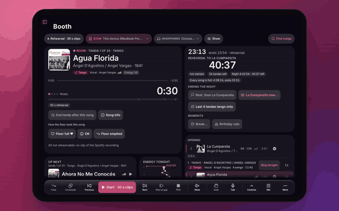
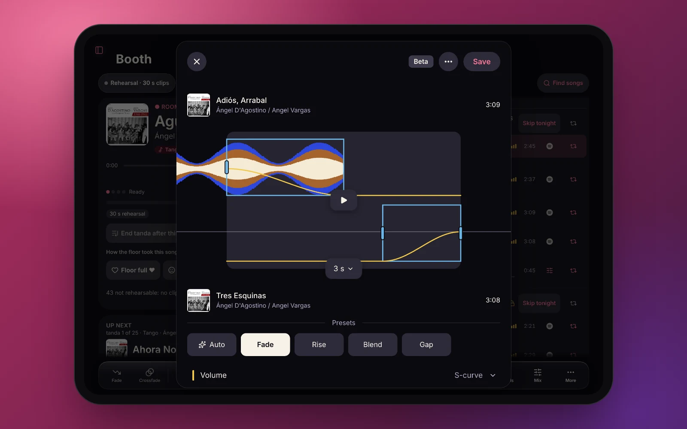
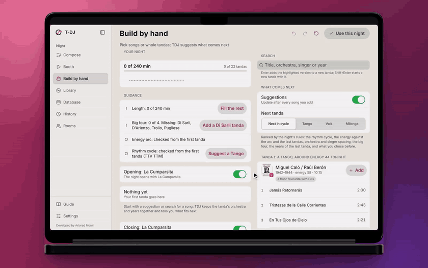
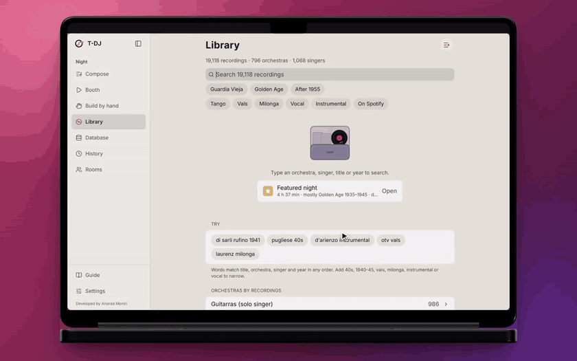
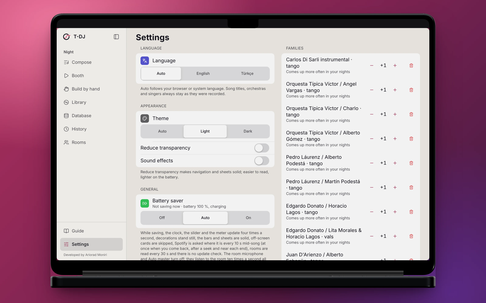
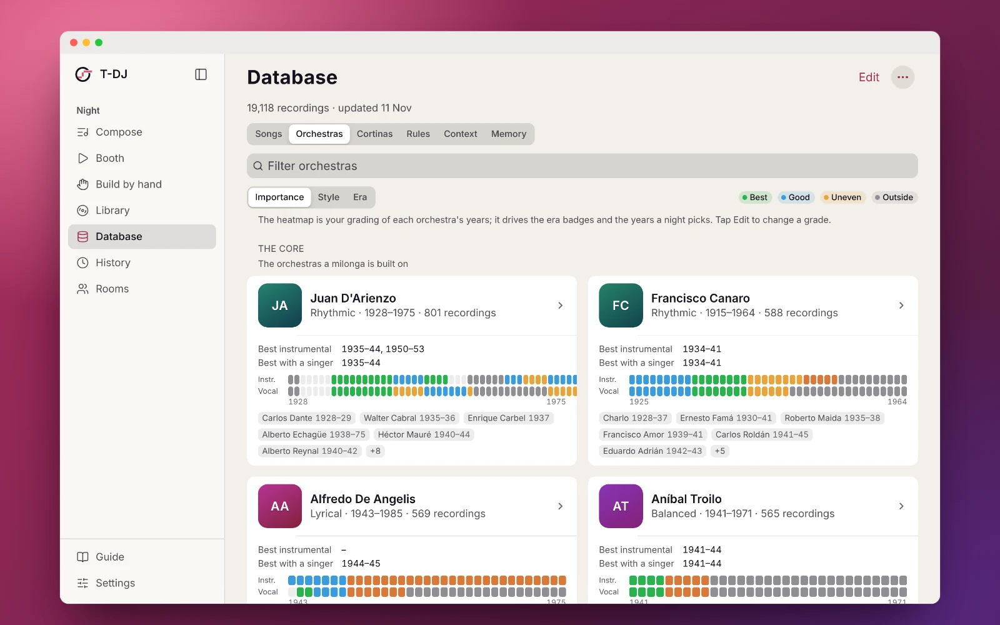
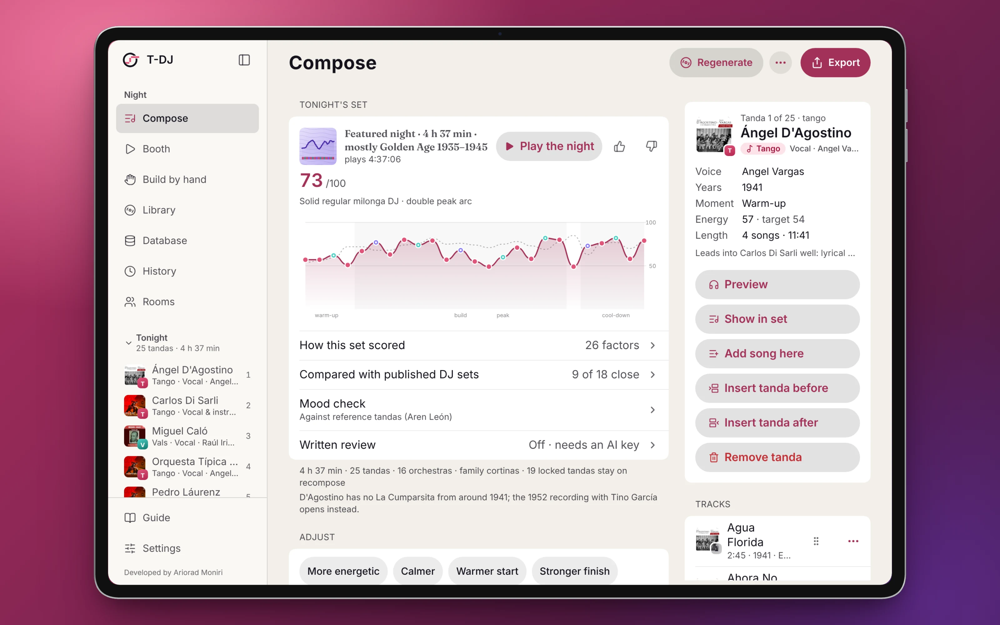

<p align="center"><picture><source media="(prefers-color-scheme: dark)" srcset="brand/logo-reversed.svg"/></picture></p>
<h1 align="center">T-DJ</h1>
<p align="center">Build a milonga the way a tango DJ does: tandas, cortinas and the shape of the night.</p>

<p align="center"><a href="media/readme/compose.mp4"></a></p>

I play milongas in Istanbul. For years I built every night by hand, checking that no orchestra came back too
soon and that each cortina fit the tanda after it. T-DJ is the tool I wanted for that job. It drafts a whole night
from an index of about 19,000 recordings, then lets me change what I don't like before I play it, and plays it.

## Get it

<p>
  <a href="https://github.com/ArioMoniri/TDJ/releases"></a>
  <!-- app-store:coming-soon (scripts/release/readme-store-badge.mjs removes this line and the "coming soon" note once App Review approves) -->
  <a href="https://apps.apple.com/app/id6834924534"></a>
  <sub data-store-status="coming-soon"><b>App Store: coming soon</b></sub>
</p>

The Mac app comes as one DMG for Apple silicon and Intel, macOS 13 or later, signed and notarised. It is attached
to each published release on the [Releases page](https://github.com/ArioMoniri/TDJ/releases), together with a
`SHA256SUMS` file, so you can check your download with `shasum -a 256 -c SHA256SUMS`. The App Store build runs on
the Mac and on the iPad.

**Try it on the web:** <https://d3k5k2c1l0s5ri.cloudfront.net>. Nothing to install, and any key you add stays in
your browser.

## What it does

**Composes a night.** Choose the length and the era, press Compose. You get tandas in a TTVTTM cycle, a cortina
picked for the tanda that follows it, an energy arc with a breather between two peaks, and a score that tells you
what it checked. Each night gets its own cover, drawn from its arc, with an era label that follows what is
actually in it. The featured night is mine: 25 tandas, 4 h 35 min of the golden age with Turkish cortinas.


**Plays it in the Booth.** The Booth plays the night from your own files, from Spotify, or as 30-second
rehearsal clips, with real gaps, level matching and a fade at the end of each cortina. Cortinas start at their
chorus, so the room knows a cortina when it hears one; you can move the start per cortina.

<a href="media/readme/booth.mp4"></a>

On an iPad in landscape the Booth is one screen: what plays now, the clock to La Cumparsita, the set list in its
own column, and one row of transport buttons at the bottom. What I use during a night:

- Tap any song or cortina to play it. Before the night it plays in the room; once the night has started it goes
  to your headphones first, and Play now in the room needs a confirmation. Previous, Next, Fade and Crossfade are
  press-and-hold mid-night, so a stray tap never cuts a song. You can switch that off in Settings.
- A seek bar, a start point per song, and drag (or Move up / down) to change the order inside a tanda.
- Controls opens one panel with everything else: transport, loudness trim, cue, mixer, timing, the floor.
- Find songs searches tonight's tandas or the whole catalogue, and Swap replaces a song while the room dances.
- The marker between two songs opens the transition editor: Auto, Fade, Rise, Blend or Gap, with the overlap,
  curves and EQ, and a play button to hear it.
- Pick your headphones as a second output to pre-listen without the room hearing it.

<p>


</p>

**Spotify on the iPad and the phone.** Safari on an iPad or an iPhone can't play Spotify in the page, so the Booth
plays through the Spotify app instead (Spotify Connect, Premium needed). The ROOM menu lists your Spotify devices;
pick one and start, pause, stop and seek all work from T-DJ. When something goes wrong the Booth says so in plain
words, such as "Spotify · pick a device" or a session that needs a new login, with one button to fix it. It never
skips the rest of the night because one start failed.

**Build by hand.** If you'd rather pick every tanda yourself, Build by hand keeps a checklist next to your night:
the length against the target, the big four, the energy arc, the rhythm cycle and the cortinas, each with a
one-tap fix. On the right it suggests whole tandas for the next slot and says why each one fits.

<a href="media/readme/build.mp4"></a>

**Search that forgives typing.** The Library and the Database share one search. It ignores accents and copes
with typos ("ventaron" finds Ventarrón), and you can type words in any order: "di sarli 1941 instrumental",
"pugliese 40s", "otv vals". Tap a row to hear it.

<a href="media/readme/search.mp4"></a>

**Learns what works on the floor.** In the Booth I mark a song Floor full, OK or Floor emptied. Dancers can open
the room's link on their phones and heart the song that is playing; nobody's name is kept, only counts. Popularity
from published DJ sets, set lists and Deezer gives a starting point before you have reactions of your own. A
favourite weighs more in the part of the night where it worked, and never overrides a tanda rule. Praise a tanda
and it counts as one Floor full for its songs.


Your edits teach it too: swaps, pinned tandas, thumbs up and down on a night. Settings shows what it learned as a
list you can weigh up or down, delete, or switch off.



**Asks before breaking a rule.** If an edit would break a tanda rule (two orchestras in one tanda, years too far
apart), T-DJ tells you what is wrong, offers up to three alternatives, and lets you do it your way for this night
only.

**Edit with AI.** Type "make tanda 7 calmer" and you see the change as a diff, with Undo. With your own key
(Anthropic, OpenAI, Gemini or OpenRouter) a model reads the request. Without a key, T-DJ reads it by keyword,
which covers most of what I ask for in the middle of a night.

<a href="media/readme/ai-edit.mp4"></a>

**Rooms.** Two DJs can work on one night. I make a room and show the code, the other DJ joins from a phone, and
each edit shows up on both sides, with who made it in the log. On the web, rooms are kept in the deployment's
database for 90 days after the last change; the Mac and iPad apps use rooms through a linked T-DJ server.

<a href="media/readme/rooms.mp4"></a>

**Share a night.** Export, then Share: a link, a `.tdjnight` file or a QR code. It opens on any phone, iPad or Mac
and lands in History.

<a href="media/readme/share.mp4"></a>

**Your own database.** Every recording, orchestra, cortina and rule can be edited, and your edits travel with your
nights. The era badges come from the orchestra heatmap, so you can see at a glance whether a side is from an
orchestra's best years. Artwork shows on every row, with the orchestra's initials when there is
none.



The index is mostly the golden age, but contemporary orchestras can be added from their Spotify releases with
`pnpm orchestra:import`. Sexteto Cristal is the first: 27 sides from *Viento del Norte* (2018) and *Loca de amor*
(2019).

**In Turkish, too.** The app and its store pages speak Turkish as well as English. Settings → Language follows your
system or lets you choose.


It runs on the iPad and the phone as well, and there is a dark mode for a dim room.

<p>


</p>

More screens: [Booth on iPad](media/readme/booth.webp) · [Build by hand](media/readme/build.webp) ·
[search](media/readme/search.webp) · [Guide](media/readme/guide.webp) · [dark Compose](media/readme/compose-dark.webp)

## Run it yourself

You can run your own copy on your own AWS account, with your own Spotify app and settings. It costs about nothing
when idle. The deploy also creates the small DynamoDB table that rooms and short links need.

```bash
git clone https://github.com/ArioMoniri/TDJ.git && cd TDJ
pnpm install
node packages/cli/bin/tdj.mjs   # asks at most three questions, then deploys
```

The details, including the GitHub-fork route that updates itself, are in [docs/SELF_DEPLOY.md](docs/SELF_DEPLOY.md)
and [docs/DEPLOY.md](docs/DEPLOY.md).

## Develop

```bash
pnpm dev                       # the app on http://localhost:3000
pnpm --filter @tdj/core test   # engine rules (vitest)
cd apps/web && pnpm e2e        # Playwright
pnpm index:build               # after touching data/sources
pnpm orchestra:import          # add a contemporary orchestra from Spotify
```

Musical rules change test first ([docs/TDD.md](docs/TDD.md)). `pnpm media` re-captures the clips and screens above
from the real app (run it against `next start`; see the top of `apps/web/scripts/capture-media.ts`), and
`pnpm video` renders the launch video from those clips. The long version of this page, with every feature and how
a set is built, is [docs/FEATURES.md](docs/FEATURES.md); the design is in [docs/ARCHITECTURE.md](docs/ARCHITECTURE.md).

## Credits

The index starts from *Listado Total de canciones* (2008) and the *All orchestras* heatmap, both in
`data/sources`. Previews come from Deezer and Spotify, recording dates from MusicBrainz, cortina choruses from
LRCLIB's synced lyrics. The published sets I benchmark against are listed in [docs/reviews](docs/reviews). Built
with Claude Code.

MIT licence, see [LICENSE](LICENSE). © 2026 Ario Moniri.
