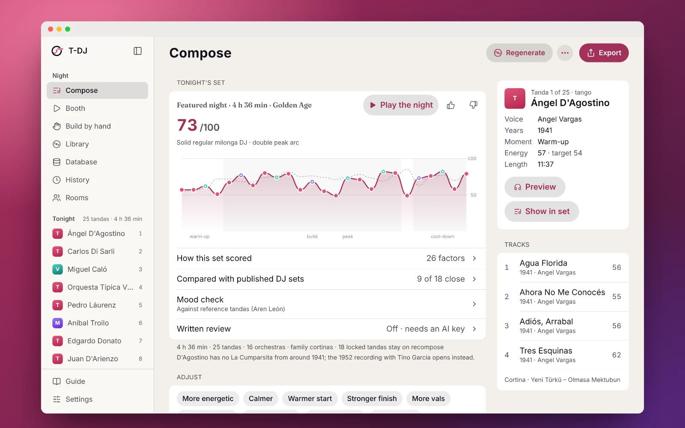
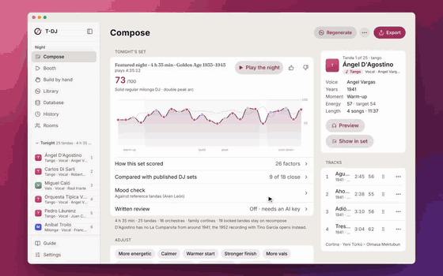
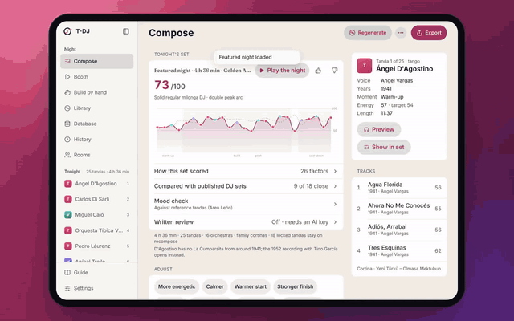
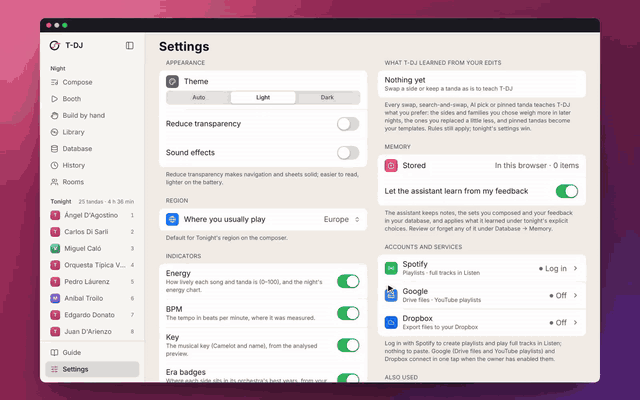

<p align="center"><picture><source media="(prefers-color-scheme: dark)" srcset="brand/logo-reversed.svg"/></picture></p>
<h1 align="center">T-DJ</h1>
<p align="center">Build a milonga the way a tango DJ does: tandas, cortinas and the shape of the night.</p>

<p align="center"><a href="media/readme/compose.mp4"></a></p>

I play milongas in Istanbul. For years I built every night by hand, checking that no orchestra came back too
soon and that each cortina fit the tanda after it. T-DJ is the tool I wanted for that job. It drafts a whole night
from an index of about 19,000 recordings, then lets me change what I don't like before I play it.

## Get it

<p>
  <a href="https://github.com/ArioMoniri/TDJ/releases/latest/download/TDJ-macOS.dmg"></a>
  <!-- app-store:coming-soon (scripts/release/readme-store-badge.mjs removes this line and the "coming soon" note once App Review approves) -->
  <a href="https://apps.apple.com/app/id6834924534"></a>
  <sub data-store-status="coming-soon"><b>App Store: coming soon</b></sub>
</p>

The DMG is one app for Apple silicon and Intel, macOS 13 or later, signed and notarised. Every release carries a
`SHA256SUMS` file with the SHA-256 of the DMG, so you can check your download with
`shasum -a 256 -c SHA256SUMS`. The App Store build runs on the Mac and on the iPad.

**Try it on the web:** <https://d3k5k2c1l0s5ri.cloudfront.net>. Nothing to install, and any key you add stays in
your browser.

## What it does

**Composes a night.** Choose the length and the era, press Compose. You get tandas in a TTVTTM cycle, a cortina
picked for the tanda that follows it, an energy arc with a breather between two peaks, and a score that tells you
what it checked. The featured night is mine: 25 tandas, 4 h 35 min of the golden age with Turkish cortinas.



**Plays it in the Booth.** The Booth plays the night from your own files or Spotify, with real gaps, level
matching and a fade at the end of each cortina. Pick your headphones as a second output and you can pre-listen to
the next song while the room keeps dancing.

<a href="media/readme/booth.mp4"></a>

**Edit with AI.** Type "make tanda 7 calmer" and you see the change as a diff, with Undo. With your own key
(Anthropic, OpenAI, Gemini or OpenRouter) a model reads the request. Without a key, T-DJ reads it by keyword,
which covers most of what I ask for in the middle of a night.

<a href="media/readme/ai-edit.mp4"></a>

**Rooms.** Two DJs can work on one night. I make a room and show the code, the other DJ joins from a phone, and
each edit shows up on both sides, with who made it in the log.

<a href="media/readme/rooms.mp4"></a>

**Share a night.** Export, then Share: a link, a `.tdjnight` file or a QR code. It opens on any phone, iPad or Mac
and lands in History.

<a href="media/readme/share.mp4"></a>

**Your own database.** Every recording, orchestra, cortina and rule can be edited, and your edits travel with your
nights. The era badges come from the orchestra heatmap, so you can see at a glance whether a side is from an
orchestra's best years.


**In Turkish, too.** Cortinas come from many cultures, Turkish among them, and the app and its store pages speak
Turkish as well as English.


It also runs on the iPad and the phone, and there is a dark mode for a dim room.

<p>
<a href="media/readme/ipad.mp4"></a>
<a href="media/readme/dark.mp4"></a>
</p>

More screens: [Booth](media/readme/booth.webp) · [Guide](media/readme/guide.webp) ·
[Settings](media/readme/settings.webp) · [dark Compose](media/readme/compose-dark.webp) ·
[iPad](media/readme/ipad.webp) · [phone](media/readme/phone.webp)

## Run it yourself

You can run your own copy on your own AWS account, with your own Spotify app and settings. It costs about nothing
when idle.

```bash
git clone https://github.com/ArioMoniri/TDJ.git && cd TDJ
pnpm install
node packages/cli/bin/tdj.mjs   # asks at most three questions, then deploys
```

The details, including the GitHub-fork route that updates itself, are in [docs/SELF_DEPLOY.md](docs/SELF_DEPLOY.md).

## Develop

```bash
pnpm dev                       # the app on http://localhost:3000
pnpm --filter @tdj/core test   # engine rules (vitest)
cd apps/web && pnpm e2e        # Playwright
pnpm index:build               # after touching data/sources
```

Musical rules change test first ([docs/TDD.md](docs/TDD.md)). `pnpm media` re-captures the clips and screens above
from the real app, and `pnpm video` renders the launch video. The long version of this page, with every feature
and how a set is built, is [docs/FEATURES.md](docs/FEATURES.md); the design is in
[docs/ARCHITECTURE.md](docs/ARCHITECTURE.md).

## Credits

The index starts from *Listado Total de canciones* (2008) and the *All orchestras* heatmap, both in
`data/sources`. Previews come from Deezer and Spotify, recording dates from MusicBrainz. The published sets I
benchmark against are listed in [docs/reviews](docs/reviews). Built with Claude Code.

MIT licence, see [LICENSE](LICENSE). © 2026 Ario Moniri.
