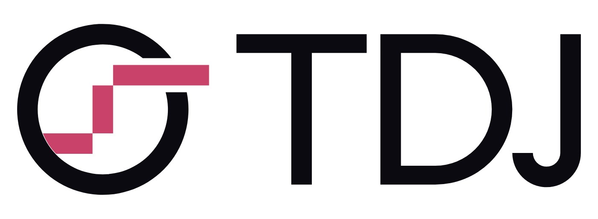

# TDJ brand

**Tanda arc** — a record whose groove rises as a tanda (slow → up → settle) and leaves the disc.
The ring is the night and the vinyl; the rose line is the music. One idea, two colours, one stroke.

## What changed in the refinement pass (round 2)

The first build (`concepts/concepts.png`, concept A) was a 270° ring with round caps and a three-step
rounded line floating inside it, on a pink gradient disc, next to a stock geometric-sans "TDJ". It read
as an icon-font glyph / stairs chart. The refined mark keeps the idea and rebuilds the craft:

- **One stroke, cut terminals.** Everything is one 24-unit stroke on a 256 grid (9.4 % of the mark, so it
  still holds at 16 px). Flat ends and square joins instead of round caps: a cut groove, not a rounded icon.
- **Full ring + overpass.** The record is a complete ring; the settle tread passes *over* it through an
  8-unit knockout on each side. That gives the line depth and direction — it is travelling out of the record,
  not plotting a chart — and resolves the loose end the old 270° ring had.
- **The line grows out of the ring.** The slow tread starts on the ring's inner edge (seam cut on the inner
  circle), rises through the centre and exits right, one stroke beyond the ring. Two phases, three segments:
  slow, up, settle.
- **Optical centring.** The ring sits at x = 120 (not 128) so the mark with its protruding tread is balanced
  in a square; the reversed versions are thinned 4 % (23-unit stroke) against irradiation.
- **Wordmark built on the same logic.** T, D, J are constructed paths (no live text): 176 cap height,
  24 stems, horizontals thinned to 22, the D's bowl is a half-record (90 × 88 outer, 66 inner), the J's hook
  (R 40) tucks under the D with 3 units of overshoot below the baseline. Spacing is optical: T–D tight
  (16), D–J open (56) so the hook clears the bowl.
- **Colour, not gradient.** Flat ink ring + rose line. Gradient removed.

Tests run (`preview.png`): size ladder 16–256 px, 16/32/48 px pixel test, one-colour black/white,
greyscale, squint, mirror, 180° rotation, brand / photo / pattern backgrounds, favicon, app icon,
avatar crop, header, card. Rotated 180° the mark reads the same way (a ring with a rising step); mirrored it
reads as a falling step; neither gives an unintended word or symbol. At 16 px the overpass gaps close, so
`logo-small.svg` (no knockouts) is the favicon/app-icon source.

## Files

| File | Use |
|---|---|
| `logo.svg` | Primary symbol, ink ring + rose line, light backgrounds |
| `logo-mono.svg` | One-colour ink (print, embroidery, engraving) |
| `logo-dark.svg` | Dark backgrounds: cream ring (thinned) + light rose line |
| `logo-reversed.svg` | One-colour cream, thinned, for ink/rose backgrounds |
| `logo-small.svg` | Small-size cut (no overpass gaps) — favicon source, ≤ 24 px |
| `lockup.svg` / `lockup-mono.svg` / `lockup-dark.svg` | Horizontal lockup (symbol + TDJ), 698 × 256 |
| `lockup-stacked.svg` (+ `-mono`, `-dark`) | Stacked lockup, 448 × 480, square formats and social |
| `logo-app-icon.svg` | Ink tile, rx 22 %, mark at 64 %, nudged up 2 % (same as `apps/web/public/icon.svg`) |
| `logo-animated.svg` | SMIL: the record draws on, then the tanda line; final frame equals the master |
| `variants/` | `export_variants.py` output: black, white, mono-rose, square, favicon, app icon; lockup black/white/mono |
| `logo-512.png`, `lockup.png`, `preview.png`, `board.png` | Raster exports, test sheet, presentation board |

The symbol masters are filled paths (no strokes, no masks, no text); run *Unite* in a vector editor if a cutter
or embroidery shop needs one outline. The app component `apps/web/src/components/Logo.tsx` carries the same
path data with the ring on `currentColor`.

## Colour

| Name | HEX | RGB | Use |
|---|---|---|---|
| Ink | `#0B0A10` | 11 10 16 | Record ring and letters on light; app tile; dark UI background |
| Rose | `#C9426A` | 201 66 106 | The tanda line on light backgrounds; primary actions only (4.6:1 on white) |
| Rose (on dark) | `#E0557A` | 224 85 122 | The tanda line on ink |
| Cream | `#F6F1E8` | 246 241 232 | Ring and letters on dark; light background |

Approved pairs: ink + rose on cream/white (`logo.svg`); cream + rose on ink (`logo-dark.svg`); one-colour ink on
light; one-colour cream on ink or on rose (`logo-reversed.svg`). Never rose line on a rose background.
Secondary palette (UI only, not in the logo): gold `#E8B85A` (golden age), teal `#4FD1C5` (vals), violet
`#8B7CF6` (milonga). Specify Pantone/CMYK at the first print job (rose ≈ Pantone 7424 C).

## Usage rules

- **Clear space**: one stroke width (24/256 of the symbol height) on all sides; for the lockup, the T stem width.
- **Minimum size**: symbol 16 px / 5 mm (use `logo-small.svg` below 24 px); horizontal lockup 88 px / 25 mm
  wide; stacked 64 px / 18 mm wide.
- **Lockups are fixed**: symbol height 200 = 1.14 × cap height, gap symbol→T = 32 from the tread's end; do not
  rearrange, re-space or set TDJ in a font.
- **Do not**: rotate, add gradients or shadows, outline, change the stroke, round the corners, recolour the ring
  (the line may be ink or cream in one-colour use, never another hue), put it on busy photos without the tile.
- **Type**: the wordmark is custom; UI type stays serif display (New York / Playfair) for headlines, SF Pro /
  Inter for interface.
- **Motion**: build from the construction — the record draws on clockwise, the line draws on from the ring
  outwards; resolve on the master. 1–2 s stings; no spinning of the final mark (the overpass breaks).
- **Open items**: trademark search and reverse-image check before launch; print proofs for the rose.
